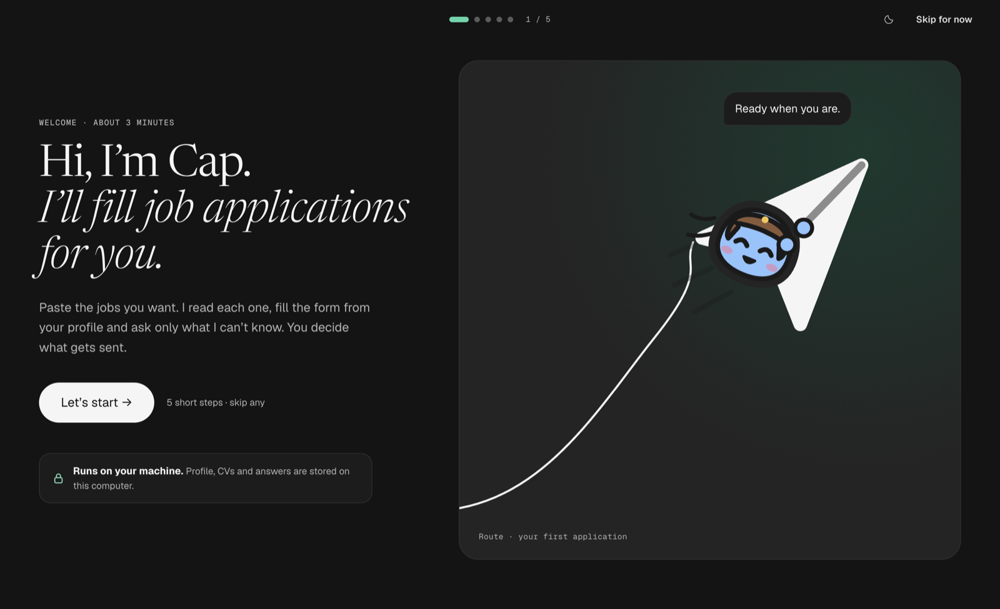
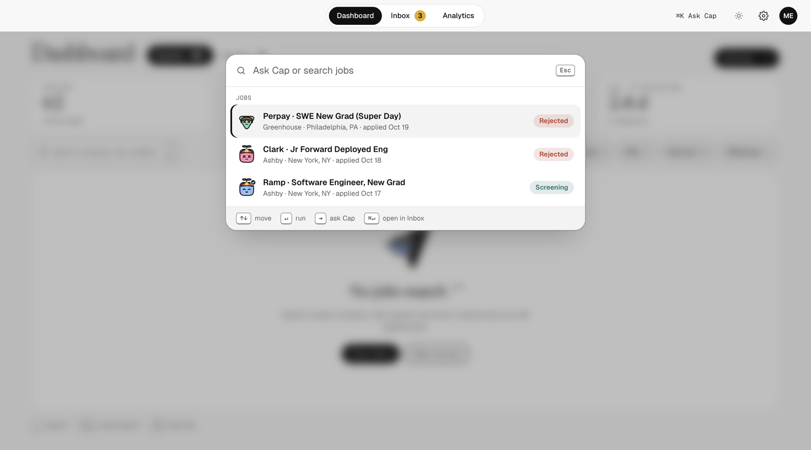
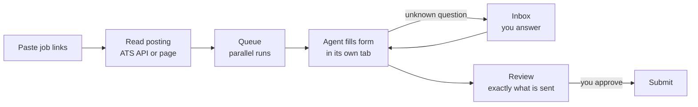

<div align="center">

# JobPilot

**A desktop app that applies to jobs for you, in parallel, and never sends anything you haven't seen.**

[](https://github.com/sadowb/jobPilot/actions/workflows/ci.yml)


[](LICENSE)



</div>

---

## What it does

Paste a stack of job links. JobPilot reads each posting, fills the application from your profile, CV and saved answers, and asks you only what it can't know. **You review exactly what will be sent before anything is submitted.**

- **Parallel crew.** Several agents work through your queue at once, each in its own browser tab.
- **Asks, doesn't guess.** Questions it can't answer from your profile land in the Inbox with a drafted answer for you to accept, edit or skip.
- **Local first.** Your profile, CVs and answers live in an encrypted database on your Mac. No account, no server, no telemetry.
- **Learns over time.** Your answers and each site's quirks are remembered, so the next application on the same site is faster.

## A look inside

> Screens below are rendered from the real app with sample data. The engine behind them is being wired up; see [Status](#status).

### Inbox: review what will be sent

Every application waits here until you accept it. The right panel shows exactly what the form will receive.

<picture>
  <source media="(prefers-color-scheme: dark)" srcset="docs/screenshots/inbox-dark.png">
  
</picture>

### Analytics: what's working

Funnel, reply rate over time, and which site, CV and role level get replies, with a short read from Cap on each.

<picture>
  <source media="(prefers-color-scheme: dark)" srcset="docs/screenshots/analytics-dark.png">
  
</picture>

### Ask Cap, from anywhere

<kbd>⌘</kbd> <kbd>K</kbd> searches your jobs or asks Cap a question. The whole app is keyboard-first.

<picture>
  <source media="(prefers-color-scheme: dark)" srcset="docs/screenshots/cmdk-dark.png">
  
</picture>

## How it works



- **Known job sites** (Greenhouse, Lever, Ashby, Workable, SmartRecruiters, BambooHR) are read through their public APIs, so questions are known up front. Other career pages are read by the agent.
- **The app owns the state.** Agents return structured results that are validated before use. Submitting needs your approval, bound to the exact form contents.
- **Any agent.** Runs go through one provider interface. Claude (your installed `claude` CLI, or an API key) is first; Codex and others follow.

More: [architecture](docs/architecture.md) · [decision records](docs/adr/) · [UI spec](docs/FRONTEND.md)

## Status

| Area                                                       | State        |
| ---------------------------------------------------------- | ------------ |
| Encrypted local database, migrations, backups              | ✅ Done      |
| Add jobs by URL, ATS readers, SSRF-safe fetching           | ✅ Done      |
| Parallel run queue, browser hookup, Claude agent provider  | ✅ Done      |
| API key storage (optional)                                 | ✅ Done      |
| Add many jobs at once                                      | 🔧 In review |
| Use your installed `claude` login                          | ⏳ Next      |
| First real application end to end (fill, review, submit)   | ⏳ Next      |
| First-launch onboarding on real data                       | ⏳ Next      |
| Memory, inbox email signals, site accounts, release builds | 🗓 Planned    |

Progress is tracked in [issues](https://github.com/sadowb/jobPilot/issues).

## Principles

- **Nothing is sent without you.** Every submission shows the exact fields and files first.
- **A guest on your Mac.** Writes only inside its own app-data folder, never changes your tools or settings, adds no login item or background service, and stops every agent and tab when you quit.
- **Libraries over custom code** wherever reliability matters.

## Getting started

Requires macOS on Apple Silicon and Node 22.

```bash
npm ci
npm run dev          # Electron with hot reload
```

<details>
<summary>All commands</summary>

```bash
npm run typecheck && npm run lint && npm run format:check && npm test
npm run build        # typecheck + electron-vite build -> out/
npm run start        # production build, unpackaged
npm run dist:dir     # packaged app, unpacked, in release/ (quick smoke test)
npm run dist         # package for this OS -> release/
npm run e2e          # Playwright journeys against the built app
npm run tokens       # regenerate styles/tokens.css from design/tokens.json
npm run db:generate  # migration after an entity change (then npm run db:check)
```

</details>

## Tech

Electron 45 · React 19 · TypeScript · Tailwind CSS 4 · SQLCipher (`better-sqlite3-multiple-ciphers`) · Drizzle ORM · liteque · zod · pino · Claude Agent SDK · Playwright

## Project layout

```
src/main/app/        bootstrap, windows, security, app:// protocol
src/main/modules/    one folder per feature: controller -> service -> repository -> entity
src/main/platform/   db, queue, agents, browsers, secrets, ipc
src/preload/         contextBridge only
src/shared/          IPC channels + zod DTOs shared by main and renderer
src/renderer/        React UI
e2e/                 Playwright journeys against the built app
design/v17/          design boards (source of truth for the UI)
```

Contributor and agent rules: [AGENTS.md](AGENTS.md). How work flows from issue to merged PR: [docs/FACTORY.md](docs/FACTORY.md).

## Security

- Renderer: `contextIsolation`, `sandbox`, no Node, served from `app://jobpilot/`, strict CSP, navigation and `window.open` locked, only `https:` links open externally.
- Electron fuses: RunAsNode, `NODE_OPTIONS`, `--inspect` and file-protocol privileges off; cookie encryption and asar integrity on.
- Data: SQLCipher database with its key in the macOS Keychain; every IPC payload, agent output and HTTP response is validated with zod; outbound fetches are SSRF-checked.
- CI: gitleaks, zizmor, `npm audit`, CodeQL and secret-scanning push protection.

<details>
<summary><strong>Visual regression</strong> (pixel comparison of every screen, light and dark)</summary>

```bash
# 1. build each tree you want to compare
(cd <worktree> && npx electron-vite build)
# 2. capture every screen, light and dark (fresh user-data dir, fixed 1440x900 window)
npm run visual:capture -- --app <worktree> --out /tmp/vis/head [--only <substring>]
# 3. compare against a baseline capture; exit code 1 if any screen FAILs
npm run visual:diff -- --base /tmp/vis/base --head /tmp/vis/head --out /tmp/vis/report [--threshold 0.001]
```

- `scripts/visual/screens.mjs` declares screens and overlay actions; `scripts/visual/fixture.json` is the fake localStorage seed, reapplied before every page load.
- Determinism: fresh `--user-data-dir` per launch, theme through the `theme-preference` file, `reducedMotion: reduce`, frozen `Date`, fonts + network idle + two animation frames before each shot, caret hidden.
- Report: `report.md` (FAIL first) and `report.html` (base | head | diff). FAIL means more than 0.1% of pixels changed, a size mismatch, a missing file or a capture error.
- Limits: compare captures from the same machine (device scale factor); timers still run; a screen whose selector fails is recorded as ERROR.

</details>

## License

[MIT](LICENSE)
