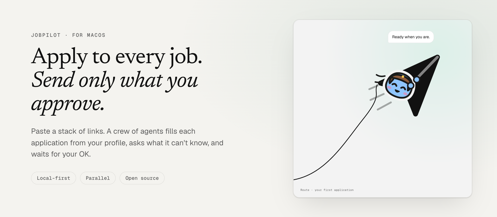
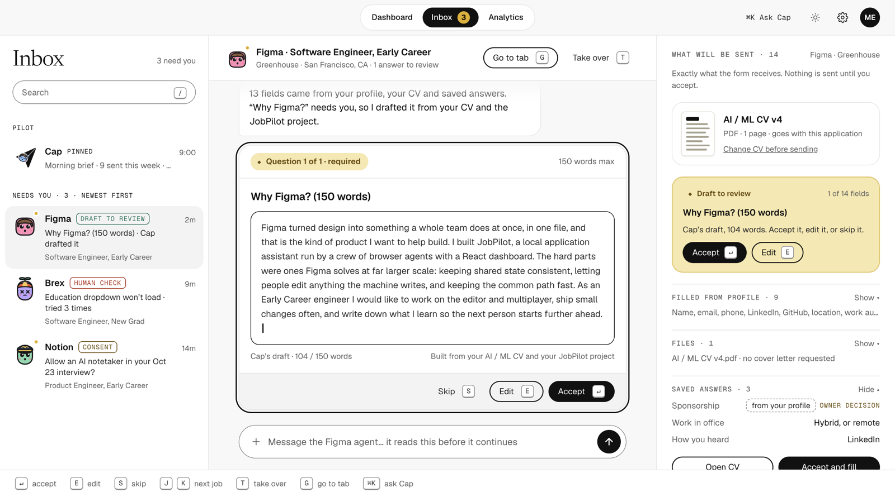
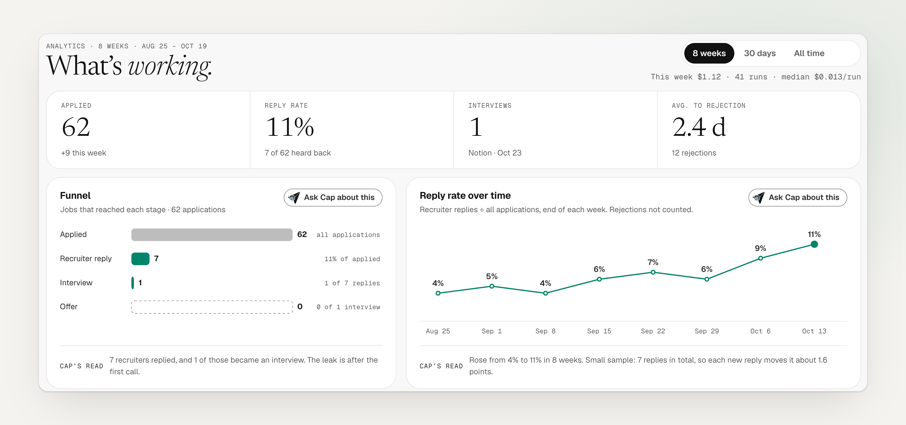
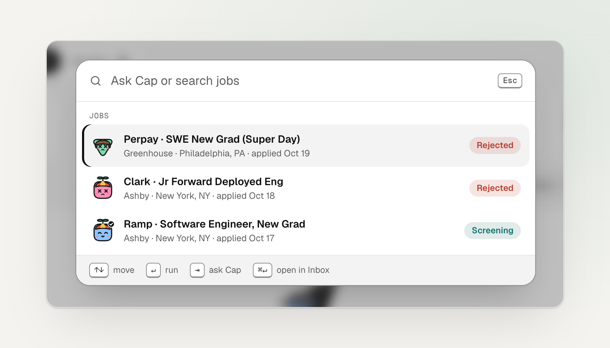

<picture>
  <source media="(prefers-color-scheme: dark)" srcset="docs/screenshots/banner-dark.png">
  
</picture>

  <a href="#how-it-works">How it works</a> ·
  <a href="#download">Download</a> ·
  <a href="#status">Status</a> ·
  <a href="docs/DEVELOPMENT.md">Development</a> ·
  <a href="docs/architecture.md">Architecture</a>

JobPilot is an Electron desktop app that applies to jobs for you. Paste a stack of links: a crew of agents reads each posting, fills the form from your profile, CV and saved answers, and asks you only what it can't know. **Nothing is submitted until you've seen exactly what will be sent.**

## Review before anything is sent

Every application stops in the Inbox. Cap drafts the answers it couldn't fill; the right panel shows the exact fields and files the form will receive.

<picture>
  <source media="(prefers-color-scheme: dark)" srcset="docs/screenshots/inbox-dark.png">
  
</picture>

## See what's working

Your funnel, reply rate over time, and which site, CV and role level get replies.

<picture>
  <source media="(prefers-color-scheme: dark)" srcset="docs/screenshots/analytics-dark.png">
  
</picture>

## Keyboard-first

<kbd>⌘</kbd> <kbd>K</kbd> searches every job or asks Cap a question. Every screen has shortcuts.

<picture>
  <source media="(prefers-color-scheme: dark)" srcset="docs/screenshots/palette-dark.png">
  
</picture>

Screens are from the real app with sample data.

## How it works

1. **Paste links.** Greenhouse, Lever, Ashby, Workable, SmartRecruiters and BambooHR are read through their public APIs; other career pages are read by the agent.
2. **The crew runs in parallel**, each agent in its own browser tab.
3. **Unknown questions come to you** in the Inbox, with a drafted answer.
4. **You approve, it submits.** Approval is bound to the exact form contents.

Everything stays on your computer: an encrypted local database, no account, no server, no telemetry. JobPilot writes only to its own folder and stops every agent when you quit.

## Download

Get the latest build from [Releases](https://github.com/sadowb/jobPilot/releases):

- **macOS (Apple silicon)**: DMG (`JobPilot-<version>-arm64.dmg`)
- **Windows (x64)**: installer (`JobPilot-<version>-x64-setup.exe`)
- **Ubuntu / Debian**: `.deb` (`sudo apt install ./JobPilot-<version>-amd64.deb`)
- **Other Linux distros**: AppImage (`JobPilot-<version>-x64.AppImage`; note it needs `libfuse2` and unprivileged user namespaces)

Builds are pre-releases while the app is unfinished and are not notarized, so each OS asks you to confirm the first open. Steps and how to verify a download (`gh attestation verify`) are in [docs/RELEASE.md](docs/RELEASE.md).

## Status

Early development. The engine (encrypted storage, job readers, parallel run queue, Claude agent) is in place; the first end-to-end application is next. Follow along in [issues](https://github.com/sadowb/jobPilot/issues).

## License

[MIT](LICENSE)
