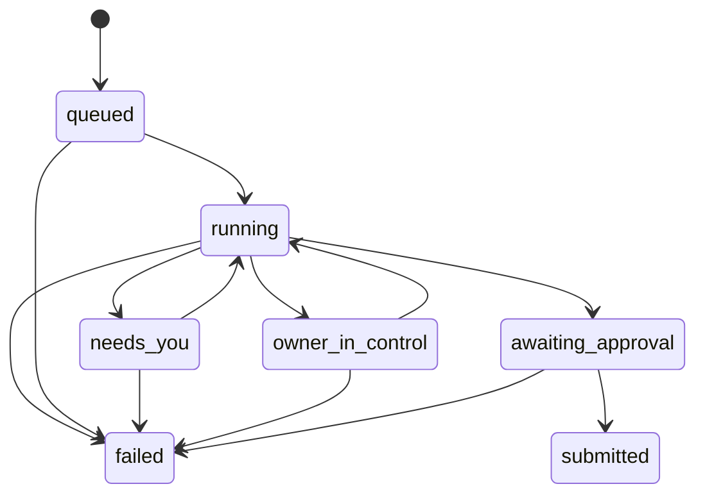
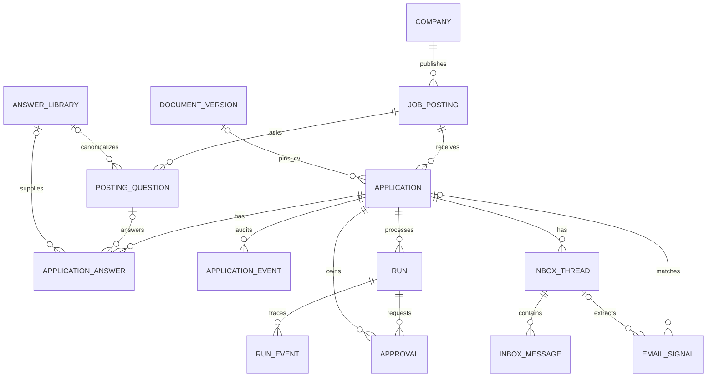
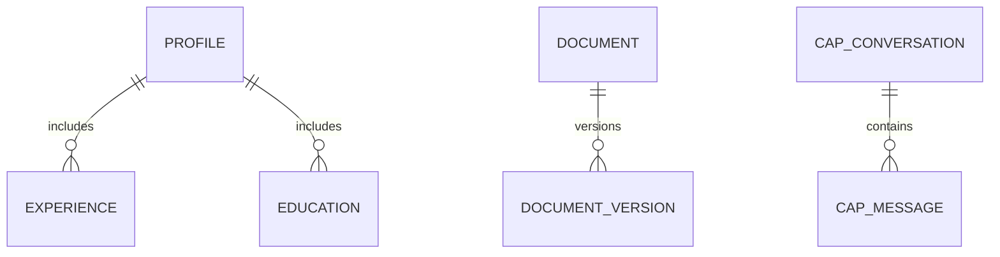
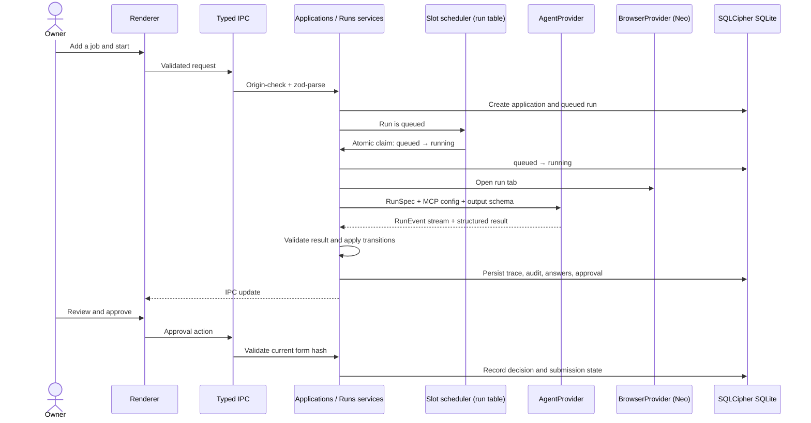

# JobPilot architecture

JobPilot is a local-first Electron desktop app for one owner. The renderer presents the V17 UI; the main process owns data, orchestration, state transitions, credentials, and submission. JobPilot opens no network listeners. Agent MCP servers use stdio, except the externally installed Neo app: JobPilot connects as a client to its loopback Streamable HTTP endpoint ([adapter reference](reference/neo.md)).

## System overview

```mermaid
flowchart LR
  Owner[Owner] --> Renderer[React renderer]
  Renderer -->|typed IPC: zod + sender origin check| Preload[Context bridge]
  Preload --> Main[Electron main process]
  Main --> Modules[Feature modules]
  Modules --> DB[(SQLCipher SQLite<br/>Drizzle + migrations)]
  Modules --> Queue[run table + slot scheduler]
  Queue --> Agents[AgentProvider]
  Agents --> Claude[Claude Agent SDK]
  Agents --> Codex[Codex SDK]
  Agents --> CLI[CLI adapters via execa]
  Agents --> Browser[BrowserProvider: Neo]
  Agents --> Memory[Mnemosyne MCP via on-demand uv (ADR 0015)]
  Modules --> Secrets[Keychain / safeStorage: DB key]
  Agents --> Vault[Bitwarden MCP: dedicated job-site vault]
  Modules --> Logs[LogService + RunTraceService + AuditService]
  Browser --> Sites[ATS / career sites]
  Modules --> Mail[Email provider]
```

## Run state machine

The run row is authoritative. The application service applies validated agent results and owns every transition. A partial unique index permits at most one `queued` or `running` run per application. Starting a new attempt retires a run still in `needs_you` or `awaiting_approval`: it moves to `failed` ("Replaced by a new attempt"), its pending approval to `expired`, and its tab is closed, so an application never holds two live attempts. Submission requires a pending approval bound to the current form hash unless auto mode is explicitly enabled.



`needs_you` represents an owner answer or intervention. `owner_in_control` represents an active takeover. The agent result vocabulary (`filled`, `needs_answers`, `blocked`, `submitted`, `failed`) is an input contract; the service maps it to run and application states.

## Job-side ERD



## Owner-side ERD



`site_account`, `email_signal`, and `settings` are owner records with no required parent. `site_account` holds login metadata only; passwords live in a dedicated Bitwarden account (ADR 0013). Mnemosyne owns its separate memory store; it is not part of this ERD.

## Run flow



## Data and trust boundaries

- [ADR 0016: Gentle footprint](adr/0016-gentle-footprint.md) binds every lane and review: JobPilot owns only its `userData`, explicitly exported files and run-scoped processes/tabs. It leaves installed tools and unrelated browser state untouched, adds no background presence and limits resource use and network access. The ADR records implementation gaps separately from the policy.
- SQLite uses SQLCipher, WAL, foreign keys, STRICT tables, ULID text keys, and Unix-millisecond integer timestamps. Drizzle owns table definitions and migrations. Views are maintained in `drizzle/0001_views.sql` and have typed `.existing()` handles.
- IPC, agent outputs, ATS/HTTP responses, and imported files are parsed with zod at entry. The main process is the only writer of product state.
- The renderer has no Node access. The preload exposes named operations only. IPC accepts only the trusted main frame from the app origin (or configured development origin).
- The SQLCipher key lives in Keychain via Electron `safeStorage`; builds are signed with one stable self-signed certificate so updates keep Keychain access (ADR 0014). Job-site passwords live in a dedicated Bitwarden account reached through the official Bitwarden MCP (ADR 0013). Logs and run traces are redacted.
- Every state change is auditable. Agent events are stored in `run_event` and mirrored to per-run JSONL logs.

## Logging and diagnostics

LogService (`modules/observability/log.service.ts`) is pino writing through `pino.destination({ sync: true })` (sonic-boom) to `userData/logs/main.log`: one JSON object per line, one child logger per module with `run_id`/`application_id`/`job_id`/`agent` fields. The path is inside `userData` (ADR 0016), the directory is mode 0700, the file 0600. Every record passes `redact()`, plus a pass that masks emails and `sk-` keys in free text. Rotation is in-app, without a library: at startup and every 5 minutes, a log over 10 MB is renamed `main.1.log` … `main.5.log` (oldest deleted) and the destination is `reopen()`ed. Level is `info`, or `debug` when `JOBPILOT_LOG_LEVEL=debug` (zod-validated, no UI).

Crashes leave a trace: the logger initialises before `whenReady`; an uncaught exception logs `fatal`, calls `flushSync()` and quits; the app and each WebContents log `render-process-gone`, `child-process-gone`, `unresponsive`/`responsive`, `preload-error`, `did-fail-load` and `certificate-error` with reason and exit code; `crashReporter` keeps minidumps in `userData/crashes` with `uploadToServer: false`. `logs/session.lock` exists only while a session runs, so finding it at launch logs a `warn` "Previous session ended unexpectedly". Renderers report only through the zod-validated `reportRendererError` IPC. Help → Show Logs opens the folder; Help → Export Diagnostics… saves a zip (via `fflate`, the only writer-capable zip library installed) of the redacted logs, run traces, crash dump names and versions (no database, no dump contents).

## Package-by-feature layout

`src/main/modules/<feature>/` owns feature controllers, services, repositories, entities, and DTOs. Controllers parse and dispatch; services own rules and transactions; repositories access Drizzle; entities declare tables. `src/main/platform/` holds cross-cutting adapters and cannot import feature modules. `src/shared/` holds IPC and zod contracts shared with preload and renderer. The renderer stays a presentation layer.

## Read models

The screens query `v_application_list`, `v_up_next`, `v_inbox`, and `v_analytics_funnel`. They are read-only views defined in `drizzle/0001_views.sql` and represented by typed Drizzle handles alongside the related entities.

## Shutdown

One `before-quit` listener in `src/main/app/main.ts` prevents the first quit, stops owned work (runs, consolidation, memory, agents, backups) within 10 s, then calls `app.exit(0)`, which emits no further quit events. Windows sends no `before-quit` on shutdown/logoff, so each window's `session-end` runs the same cleanup; agent children are killed as a whole tree (`taskkill /T /F` on Windows, process group on macOS/Linux). Never call `app.quit()` from inside `before-quit` handling: Electron's `Browser::Quit()` overwrites its quitting state after the handlers return, so a nested quit leaves macOS running with no windows.
